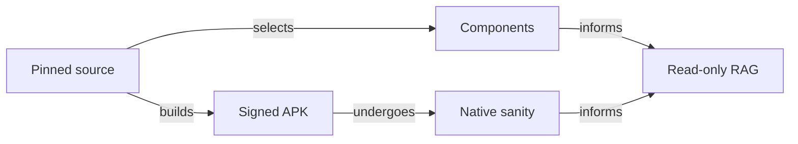

# Whist 0.24.0 qualification

## Overview

The portable presentation core, Android renderer and Web adapter have separate ownership. Component matrices carry the display combinations; native sanity checks the installed signed APK. iOS is parked.

## Evidence flow

Legend: qualification boundaries

Components verify source-owned contracts. Native selections verify the identified APK and profile; the evaluator reads both receipts.

[Component index](component/README.md) · [Native E2E index](e2e/README.md)

## Component selections

| Selection | Invocations | Execution | Report |
|---|---:|---|---|
| atf-test-android | 277 | Verified reuse | [Extent](component/atf-test-android/component-report.html) |
| atf-tests | 96 | Verified reuse | [Extent](component/atf-tests/component-report.html) |
| atf-tests-android | 52 | Verified reuse | [Extent](component/atf-tests-android/component-report.html) |
| atf-tests-documentation | 166 | Fresh execution | [Extent](component/atf-tests-documentation/component-report.html) |
| atf-tests-github | 33 | Verified reuse | [Extent](component/atf-tests-github/component-report.html) |
| atf-tests-orchestration | 78 | Verified reuse | [Extent](component/atf-tests-orchestration/component-report.html) |
| atf-tests-provenance | 120 | Verified reuse | [Extent](component/atf-tests-provenance/component-report.html) |
| atf-tests-reporting | 70 | Verified reuse | [Extent](component/atf-tests-reporting/component-report.html) |
| atf-validation | 19 | Verified reuse | [Extent](component/atf-validation/component-report.html) |
| whist-lab-app-achievements | 28 | Verified reuse | [Extent](component/whist-lab-app-achievements/component-report.html) |
| whist-lab-app-atf-card-table-ui | 8 | Verified reuse | [Extent](component/whist-lab-app-atf-card-table-ui/component-report.html) |
| whist-lab-app-bidding | 255 | Verified reuse | [Extent](component/whist-lab-app-bidding/component-report.html) |
| whist-lab-app-card-table-core | 50 | Verified reuse | [Extent](component/whist-lab-app-card-table-core/component-report.html) |
| whist-lab-app-commands | 123 | Verified reuse | [Extent](component/whist-lab-app-commands/component-report.html) |
| whist-lab-app-display | 107 | Verified reuse | [Extent](component/whist-lab-app-display/component-report.html) |
| whist-lab-app-history | 61 | Verified reuse | [Extent](component/whist-lab-app-history/component-report.html) |
| whist-lab-app-rules | 40 | Verified reuse | [Extent](component/whist-lab-app-rules/component-report.html) |

Unit prerequisites use JUnit diagnostics without Extent. Reused component reports retain their original source and receipt; they are not new executions.

## Native selections

| Selection | Invocations | Report |
|---|---:|---|
| history-release-sanity | 1 | [Extent](e2e/history-release-sanity/report.html) |
| responsive-ui-sanity | 1 | [Extent](e2e/responsive-ui-sanity/report.html) |
| signed-release-achievements | 1 | [Extent](e2e/signed-release-achievements/report.html) |
| signed-release-auto-game | 1 | [Extent](e2e/signed-release-auto-game/report.html) |
| signed-release-bidding | 1 | [Extent](e2e/signed-release-bidding/report.html) |
| signed-release-home-profile | 1 | [Extent](e2e/signed-release-home-profile/report.html) |
| signed-release-smoke | 1 | [Extent](e2e/signed-release-smoke/report.html) |

All native selections use Android API 28 at 1080×1920, density 440. Display combinations belong to components; each execution isolates and restores the original Android user.

## Provenance and limits

[Current source](apk-inputs.json) · [Component execution](component/source-component-run.json) · [Reuse decisions](component/component-reuse.json) · [APK build equivalence](diagnostics/apk-build-equivalence.json) · [Qualification plan](qualification-plan.json)

The APK was assembled before verification-only maintenance. Its bytes and native build inputs remain identical; the current validator independently admits the original execution snapshots. Web emulation does not close same-device Android Chrome acceptance.
