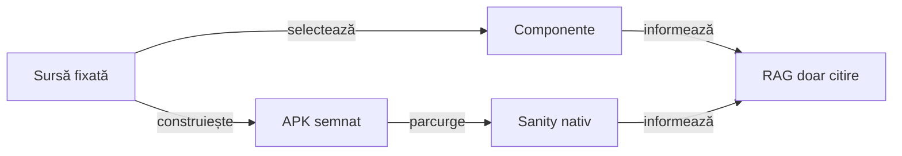

# Calificarea Whist 0.24.0

## Pe scurt

Nucleul portabil de prezentare, rendererul Android și adaptorul Web au responsabilități separate. Matricele de componentă dețin combinațiile de afișare; sanity-ul nativ verifică APK-ul semnat instalat. iOS este parcat.

## Parcursul probelor

Legendă: limitele calificării

Componentele verifică contractele deținute de sursă. Selecțiile native verifică APK-ul și profilul identificate; evaluatorul citește ambele recipise.

[Index de componente](component/README.md) · [Index E2E nativ](e2e/README.md)

## Selecții de componentă

| Selecție | Invocări | Execuție | Raport |
|---|---:|---|---|
| atf-test-android | 277 | Reutilizare verificată | [Extent](component/atf-test-android/component-report.html) |
| atf-tests | 96 | Reutilizare verificată | [Extent](component/atf-tests/component-report.html) |
| atf-tests-android | 52 | Reutilizare verificată | [Extent](component/atf-tests-android/component-report.html) |
| atf-tests-documentation | 166 | Execuție nouă | [Extent](component/atf-tests-documentation/component-report.html) |
| atf-tests-github | 33 | Reutilizare verificată | [Extent](component/atf-tests-github/component-report.html) |
| atf-tests-orchestration | 78 | Reutilizare verificată | [Extent](component/atf-tests-orchestration/component-report.html) |
| atf-tests-provenance | 120 | Reutilizare verificată | [Extent](component/atf-tests-provenance/component-report.html) |
| atf-tests-reporting | 70 | Reutilizare verificată | [Extent](component/atf-tests-reporting/component-report.html) |
| atf-validation | 19 | Reutilizare verificată | [Extent](component/atf-validation/component-report.html) |
| whist-lab-app-achievements | 28 | Reutilizare verificată | [Extent](component/whist-lab-app-achievements/component-report.html) |
| whist-lab-app-atf-card-table-ui | 8 | Reutilizare verificată | [Extent](component/whist-lab-app-atf-card-table-ui/component-report.html) |
| whist-lab-app-bidding | 255 | Reutilizare verificată | [Extent](component/whist-lab-app-bidding/component-report.html) |
| whist-lab-app-card-table-core | 50 | Reutilizare verificată | [Extent](component/whist-lab-app-card-table-core/component-report.html) |
| whist-lab-app-commands | 123 | Reutilizare verificată | [Extent](component/whist-lab-app-commands/component-report.html) |
| whist-lab-app-display | 107 | Reutilizare verificată | [Extent](component/whist-lab-app-display/component-report.html) |
| whist-lab-app-history | 61 | Reutilizare verificată | [Extent](component/whist-lab-app-history/component-report.html) |
| whist-lab-app-rules | 40 | Reutilizare verificată | [Extent](component/whist-lab-app-rules/component-report.html) |

Prerechizitele unitare folosesc diagnostice JUnit fără Extent. Rapoartele reutilizate își păstrează sursa și recipisa originale; nu sunt execuții noi.

## Selecții native

| Selecție | Invocări | Raport |
|---|---:|---|
| history-release-sanity | 1 | [Extent](e2e/history-release-sanity/report.html) |
| responsive-ui-sanity | 1 | [Extent](e2e/responsive-ui-sanity/report.html) |
| signed-release-achievements | 1 | [Extent](e2e/signed-release-achievements/report.html) |
| signed-release-auto-game | 1 | [Extent](e2e/signed-release-auto-game/report.html) |
| signed-release-bidding | 1 | [Extent](e2e/signed-release-bidding/report.html) |
| signed-release-home-profile | 1 | [Extent](e2e/signed-release-home-profile/report.html) |
| signed-release-smoke | 1 | [Extent](e2e/signed-release-smoke/report.html) |

Toate selecțiile native folosesc Android API 28 la 1080×1920, densitate 440. Combinațiile de afișare aparțin componentelor; fiecare execuție izolează și restaurează utilizatorul Android original.

## Proveniență și limite

[Sursă curentă](apk-inputs.json) · [Execuție de componentă](component/source-component-run.json) · [Decizii de reutilizare](component/component-reuse.json) · [Echivalența build-ului APK](diagnostics/apk-build-equivalence.json) · [Plan de calificare](qualification-plan.json)

APK-ul a fost construit înaintea mentenanței limitate la verificări. Octeții și intrările build-ului nativ rămân identice; validatorul curent admite independent snapshot-urile execuțiilor originale. Emularea Web nu închide acceptanța Chrome Android pe același dispozitiv.
