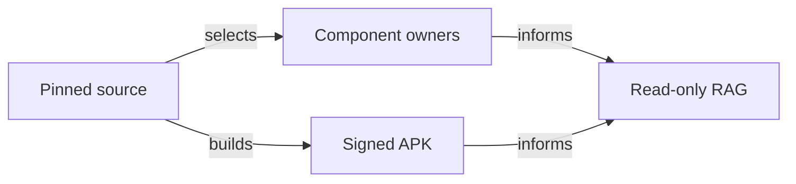

# Whist 0.24.1 qualification

## Overview

Maintenance qualification preserves every matrix pair and test identity while reducing repeated audit inputs. Source-bound components and verified artifact checks qualify the candidate; iOS is parked.

## Evidence flow

Legend: ownership and qualification

Components own exhaustive rules, geometry and history comparisons. Artifact checks verify APK identity and signing; the diff selects no new native flow.

[Component index](component/README.md) · [E2E decision](e2e/README.md)

## Component selections

| Selection | Invocations | Execution | Report |
|---|---:|---|---|
| atf-test-android | 277 | Verified reuse | [Extent](component/atf-test-android/component-report.html) |
| atf-tests | 96 | Verified reuse | [Extent](component/atf-tests/component-report.html) |
| atf-tests-android | 52 | Verified reuse | [Extent](component/atf-tests-android/component-report.html) |
| atf-tests-documentation | 166 | Fresh execution | [Extent](component/atf-tests-documentation/component-report.html) |
| atf-tests-github | 33 | Verified reuse | [Extent](component/atf-tests-github/component-report.html) |
| atf-tests-orchestration | 78 | Verified reuse | [Extent](component/atf-tests-orchestration/component-report.html) |
| atf-tests-provenance | 120 | Verified reuse | [Extent](component/atf-tests-provenance/component-report.html) |
| atf-tests-reporting | 70 | Verified reuse | [Extent](component/atf-tests-reporting/component-report.html) |
| atf-validation | 19 | Verified reuse | [Extent](component/atf-validation/component-report.html) |
| whist-lab-app-achievements | 28 | Verified reuse | [Extent](component/whist-lab-app-achievements/component-report.html) |
| whist-lab-app-atf-card-table-ui | 8 | Verified reuse | [Extent](component/whist-lab-app-atf-card-table-ui/component-report.html) |
| whist-lab-app-bidding | 255 | Verified reuse | [Extent](component/whist-lab-app-bidding/component-report.html) |
| whist-lab-app-card-table-core | 50 | Verified reuse | [Extent](component/whist-lab-app-card-table-core/component-report.html) |
| whist-lab-app-commands | 123 | Verified reuse | [Extent](component/whist-lab-app-commands/component-report.html) |
| whist-lab-app-display | 107 | Verified reuse | [Extent](component/whist-lab-app-display/component-report.html) |
| whist-lab-app-history | 61 | Verified reuse | [Extent](component/whist-lab-app-history/component-report.html) |
| whist-lab-app-rules | 40 | Verified reuse | [Extent](component/whist-lab-app-rules/component-report.html) |

Unit prerequisites retain JUnit diagnostics without Extent. Reused reports retain their original source, timing and bytes.

## Native scope

Native E2E is `NOT_RUN`: only test inputs, review metadata and Android version values changed. No previous native execution is attributed to this APK; same-device APK/Chrome acceptance remains open.

## Provenance

[APK source](apk-inputs.json) · [Component execution](component/source-component-run.json) · [Reuse decisions](component/component-reuse.json) · [Qualification plan](qualification-plan.json)

[Release catalog](../../README.md) · [Testing strategy](../../../docs/testing/README.md)
