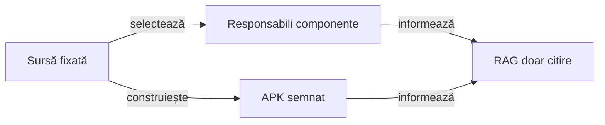

# Calificarea Whist 0.24.1

## Pe scurt

Calificarea de mentenanță păstrează fiecare pereche din matrice și identitatea testelor, reducând intrările de audit repetate. Componentele legate de sursă și controalele artefactelor califică ediția; iOS este parcat.

## Parcursul probelor

Legendă: responsabilități și calificare

Componentele dețin comparațiile exhaustive pentru reguli, geometrie și istoric. Controalele artefactelor verifică identitatea și semnarea APK-ului; diff-ul nu selectează un flux nativ nou.

[Index de componente](component/README.md) · [Decizie E2E](e2e/README.md)

## Selecții de componentă

| Selecție | Invocări | Execuție | Raport |
|---|---:|---|---|
| atf-test-android | 277 | Reutilizare verificată | [Extent](component/atf-test-android/component-report.html) |
| atf-tests | 96 | Reutilizare verificată | [Extent](component/atf-tests/component-report.html) |
| atf-tests-android | 52 | Reutilizare verificată | [Extent](component/atf-tests-android/component-report.html) |
| atf-tests-documentation | 166 | Execuție nouă | [Extent](component/atf-tests-documentation/component-report.html) |
| atf-tests-github | 33 | Reutilizare verificată | [Extent](component/atf-tests-github/component-report.html) |
| atf-tests-orchestration | 78 | Reutilizare verificată | [Extent](component/atf-tests-orchestration/component-report.html) |
| atf-tests-provenance | 120 | Reutilizare verificată | [Extent](component/atf-tests-provenance/component-report.html) |
| atf-tests-reporting | 70 | Reutilizare verificată | [Extent](component/atf-tests-reporting/component-report.html) |
| atf-validation | 19 | Reutilizare verificată | [Extent](component/atf-validation/component-report.html) |
| whist-lab-app-achievements | 28 | Reutilizare verificată | [Extent](component/whist-lab-app-achievements/component-report.html) |
| whist-lab-app-atf-card-table-ui | 8 | Reutilizare verificată | [Extent](component/whist-lab-app-atf-card-table-ui/component-report.html) |
| whist-lab-app-bidding | 255 | Reutilizare verificată | [Extent](component/whist-lab-app-bidding/component-report.html) |
| whist-lab-app-card-table-core | 50 | Reutilizare verificată | [Extent](component/whist-lab-app-card-table-core/component-report.html) |
| whist-lab-app-commands | 123 | Reutilizare verificată | [Extent](component/whist-lab-app-commands/component-report.html) |
| whist-lab-app-display | 107 | Reutilizare verificată | [Extent](component/whist-lab-app-display/component-report.html) |
| whist-lab-app-history | 61 | Reutilizare verificată | [Extent](component/whist-lab-app-history/component-report.html) |
| whist-lab-app-rules | 40 | Reutilizare verificată | [Extent](component/whist-lab-app-rules/component-report.html) |

Prerechizitele unitare păstrează diagnosticele JUnit fără Extent. Rapoartele reutilizate își păstrează sursa, timpii și octeții originali.

## Domeniu nativ

E2E nativ este `NOT_RUN`: s-au schimbat numai intrări de test, metadate de revizie și valorile versiunii Android. APK-ului nu i se atribuie execuții native anterioare; acceptanța APK/Chrome pe același dispozitiv rămâne deschisă.

## Proveniență

[Sursa APK](apk-inputs.json) · [Execuție de componentă](component/source-component-run.json) · [Decizii de reutilizare](component/component-reuse.json) · [Plan de calificare](qualification-plan.json)

[Catalogul versiunilor](../../README.md) · [Strategia de testare](../../../docs/testing/README.md)
