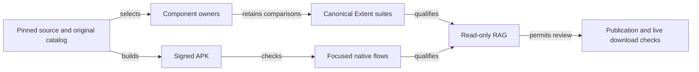

# Whist 0.25.0 qualification

## Overview

1673 component invocations and 7 signed-APK flows passed in separate scopes. Open the [primary ATF component audit](component/atf-tests/component-report.html), then the [component index](component/README.md) and [native flow index](e2e/README.md). Qualification does not claim publication or download before they are observed.

## Evidence flow

Legend: qualification and delivery remain separate

Source/catalog context identifies the original executions. Later catalog, link and download observations do not rewrite those executions.

## Identity and scope

| Boundary | Recorded identity |
|---|---|
| APK source | [4b98139a1414fa0305d5978bca3ab38ef6aea67d](https://github.com/crististefanita/whist/commit/4b98139a1414fa0305d5978bca3ab38ef6aea67d); [complete input inventory](apk-inputs.json) |
| Binary | WhistLab-0.25.0.apk; 1037745 bytes; Android version code 53 |
| Diff baseline | 0.24.2; e18de2eea56ebbccddeabd48082ff18bef4706eb |
| Plan | [Qualified selections](qualification-plan.json); Android only, iOS parked |
| Final build | [Build log](diagnostics/build-final.log) and [byte reconciliation](diagnostics/build-reconciliation.json) |
| Signing | [APK identity](diagnostics/apk-identity.json) and [certificate compatibility](diagnostics/signing-compatibility.json) |

## Reading the assertions

1. Read the declared preconditions and source identity for an invocation.
2. Follow its action and expected/actual comparisons.
3. For native flows, inspect the inline image beside that checkpoint.
4. For recovered owners, inspect the original failure and retry lineage before the final result.

The component total excludes the seven E2E invocations, overlapping source-control proofs and unit prerequisites. Reused HTML keeps its original hash and provenance. Geometry combinations stay below E2E.

## Qualification timing

[Combined stage timeline](diagnostics/release-timeline.json) retains the original, recovered and final component phases, native flows and both APK build observations. [Initial components](diagnostics/timing/components-initial.json), [invocation recovery](diagnostics/timing/components-recovered.json) and [final component reuse](component/timing.json) distinguish execution cost from source admission and sealing. These are observations of this delivery, not a statistical performance guarantee.

## Report review

Automated producer and detached-report contracts passed in the reporting collection. Interactive opening of this local HTML through Browser MCP was blocked by its URL policy and remains unverified. [Recorded review limit](diagnostics/report-review.json)

## Publication and download

[Complete download Extent](download-extent.html) and [distribution receipt](distribution-verification.json) record the actual published APK, completed bytes, SHA-256, ZIP CRC and HTTP comparisons. The main README identifies this same asset. Live catalog and retention observations remain separate from the original qualification context.

## Limits and delivery

This is an Android test channel using the existing test certificate. Native evidence covers API 28 and one readable profile; broader parity criteria remain open in [feedback](../../../docs/feedback/README.md). The final publication, download and two-release retention checks are separate observations.

[Release qualification contract](../../../docs/testing/ATF_ReleaseQualification.md) · [Shared testing strategy](../../../docs/testing/README.md)
