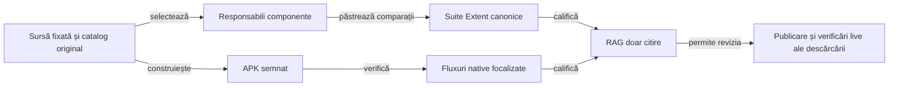

# Calificarea Whist 0.25.0

## Pe scurt

1673 de invocări de componentă și 7 fluxuri pe APK-ul semnat au trecut în domenii separate. Deschideți [auditul primar ATF de componentă](component/atf-tests/component-report.html), apoi [indexul componentelor](component/README.md) și [indexul fluxurilor native](e2e/README.md). Calificarea nu afirmă publicarea sau descărcarea înainte ca acestea să fie observate.

## Parcursul dovezilor

Legendă: calificarea și livrarea rămân separate

Contextul sursei/catalogului identifică execuțiile originale. Observațiile ulterioare ale catalogului, legăturilor și descărcării nu rescriu aceste execuții.

## Identitate și domeniu

| Graniță | Identitate înregistrată |
|---|---|
| Sursa APK | [4b98139a1414fa0305d5978bca3ab38ef6aea67d](https://github.com/crististefanita/whist/commit/4b98139a1414fa0305d5978bca3ab38ef6aea67d); [inventarul complet al intrărilor](apk-inputs.json) |
| Binar | WhistLab-0.25.0.apk; 1037745 octeți; codul versiunii Android 53 |
| Baza diff-ului | 0.24.2; e18de2eea56ebbccddeabd48082ff18bef4706eb |
| Plan | [Selecții calificate](qualification-plan.json); numai Android, iOS parcat |
| Build final | [Logul build-ului](diagnostics/build-final.log) și [reconcilierea octeților](diagnostics/build-reconciliation.json) |
| Semnare | [Identitatea APK](diagnostics/apk-identity.json) și [compatibilitatea certificatului](diagnostics/signing-compatibility.json) |

## Parcurgerea aserțiunilor

1. Citiți precondițiile declarate și identitatea sursei pentru o invocare.
2. Urmăriți acțiunea și comparațiile dintre valorile așteptate și reale.
3. Pentru fluxurile native, inspectați imaginea inline de lângă checkpoint.
4. Pentru responsabilii recuperați, inspectați eșecul original și filiația reluării înaintea rezultatului final.

Totalul componentelor exclude cele șapte invocări E2E, probele de control al sursei care se suprapun și precondițiile unitare. HTML-ul reutilizat își păstrează hash-ul și proveniența originale. Combinațiile geometrice rămân sub E2E.

## Duratele calificării

[Cronologia combinată a etapelor](diagnostics/release-timeline.json) păstrează fazele originale, recuperate și finale de componentă, fluxurile native și ambele observații ale construirii APK-ului. [Componentele inițiale](diagnostics/timing/components-initial.json), [recuperarea invocărilor](diagnostics/timing/components-recovered.json) și [reutilizarea finală a componentelor](component/timing.json) separă costul execuției de admiterea sursei și sigilare. Acestea sunt observații ale livrării curente, nu o garanție statistică de performanță.

## Revizia rapoartelor

Contractele automate ale producătorilor și rapoartelor detașate au trecut în colecția de raportare. Deschiderea interactivă a acestui HTML local prin Browser MCP a fost blocată de politica adreselor și rămâne neverificată. [Limita reviziei înregistrate](diagnostics/report-review.json)

## Publicare și descărcare

[Extent-ul descărcării complete](download-extent.html) și [receipt-ul distribuției](distribution-verification.json) înregistrează APK-ul publicat real, octeții finalizați, SHA-256, CRC ZIP și comparațiile HTTP. README-ul principal identifică același asset. Observațiile live ale catalogului și retenției rămân separate de contextul original al calificării.

## Limite și livrare

Acesta este un canal Android de test care folosește certificatul de test existent. Dovezile native acoperă API 28 și un profil lizibil; criteriile de paritate mai largi rămân deschise în [feedback](../../../docs/feedback/README.md). Verificările finale ale publicării, descărcării și retenției a două release-uri sunt observații separate.

[Contractul calificării release-ului](../../../docs/testing/ATF_ReleaseQualification.md) · [Strategia comună de testare](../../../docs/testing/README.md)
