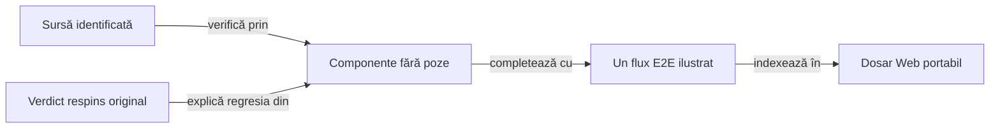

# Dosarul curent de testare Web

## Pe scurt

Index portabil pentru artefactele Whist Web. Dovezile originale rămân autonome; toate legăturile către rapoarte sunt relative și funcționează după copierea întregului dosar.

**Stare: pregătire.** Web-ul public anterior folosește revizia de cache 0.10; adaptorul corectat 0.11 este verificat separat înaintea confirmării publicării. Comparația fizică APK/Chrome rămâne deschisă.

## Cum se citește



<details>
<summary>Legendă: niveluri și limite</summary>

Componentele dețin combinațiile de dimensiuni, text, ancore și ordinea evenimentelor. E2E-ul păstrează puține parcursuri relevante, cu pași înainte/după și poze; un raport de referință nu devine calificare curentă prin copiere.

</details>

## Rapoarte și proveniență

| Raport | Verdict original | Rol | Revizia validatorului |
|---|---|---|---|
| [Trecerile curente ilustrate](e2e/oh-hell/extent.html) | `PASS` | `PRIMARY` | `91716314` |
| [Contractele intrărilor raportului și urmelor](component/reporting/component-report.html) | `PASS` | `REUSED` | `91716314` |
| [Geometria comună și matricile controlate](component/native-ports/component-report.html) | `PASS` | `REUSED` | `9ec0b560` |
| [Referința de guvernanță ATF](governance/atf/component-report.html) | `PASS` | `REFERENCE` | `9cc19f7f` |
| [Referința parcursului românesc anterior](reference/romanian/extent.html) | `PASS` | `REFERENCE` | `91716314` |
| [Deplasarea originală la trecerea AI–om](diagnostics/anchor-before/extent.html) | `FAIL` | `REJECTED` | `91716314` |

## Categorii

- [Componente](component/README.md): precondiții, date controlate, comparații și cazuri negative, fără poze ale produsului.
- [E2E](e2e/README.md): acțiuni și observații ordonate, aserțiuni individuale și capturi inline.
- [Guvernanță](governance/README.md): contracte de sursă, documentație și inventar.
- [Referințe](reference/README.md): acoperire anterioară cu limite explicite.
- [Diagnostice](diagnostics/README.md): probe respinse păstrate integral.

## Integritate și întreținere

[Manifestul](index.json) păstrează mărimea, SHA-256, rolul și proveniența fiecărui raport. Nu păstrăm PNG-uri duplicate, XML-uri JUnit ori build-uri în acest dosar; rapoartele conțin imaginile inline.

```powershell
node .\atf-tests\tools\web-release-dossier.mjs $ProjectRoot
```

Actualizați dosarul după calificarea și verificarea publicării Web; păstrați octeții și verdictele originale când mutați un raport. Documentația urmează limba ramurii, iar HTML-urile originale rămân identice. [Catalog Android](../README.md) · [Strategia de testare](../../docs/testing/README.md)
