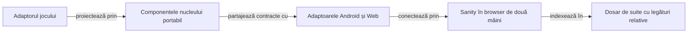

# Dosarul curent de testare Web

## Pe scurt

Index portabil de suite cu legături relative și HTML original imuabil. Domeniul curent: componente legate de sursă și un flux scurt în browserul local. Acceptarea publicării statice și a widgeturilor native rămâne deschisă; revizia publică precedentă are propria dovadă păstrată.

## Parcurs de lectură



<details>
<summary>Legendă: limitele dovezilor</summary>

Componentele dețin combinațiile și cazurile negative deliberate, fără poze. Unitățile prealabile nu au Extent. E2E-ul scurt ilustrează acțiuni și observații reale; planurile logice egale nu dovedesc fonturile desenate nativ.

</details>

## Rapoarte și proveniență

| Raport | Verdict original | Rol | Revizia validatorului |
|---|---|---|---|
| [Sanity Web de două mâini](e2e/table-sanity/extent.html) | `PASS` | `PRIMARY` | `87f47c29` |
| [Contractele comune ale adaptoarelor](component/adapters/component-report.html) | `PASS` | `PRIMARY` | `87f47c29` |
| [Componentele nucleului portabil](component/core/component-report.html) | `PASS` | `PRIMARY` | `87f47c29` |
| [Intrările de audit ale matricelor focalizate](component/matrix/component-report.html) | `PASS` | `PRIMARY` | `87f47c29` |
| [Controlul de guvernanță reluat](governance/resume/component-report.html) | `PASS` | `PRIMARY` | `838afaca` |
| [Lotul inițial cu eșec parțial](diagnostics/initial-governance/component-report.html) | `FAIL` | `REJECTED` | `87f47c29` |

## Categorii

- [Componente](component/README.md): intrări controlate, comparații și cazuri negative
- [E2E](e2e/README.md): pași ordonați, aserțiuni și patru capturi inline
- [Guvernanță](governance/README.md): verdicte originale, reluare focalizată și revizuirea rapoartelor
- [Referințe](reference/README.md): livrarea publică precedentă, cu domeniu explicit
- [Diagnostic](diagnostics/README.md): eșecul original păstrat

## Selecție și limite

- [Matricea modul × nivel](../../docs/testing/ATF_TestingGuide.md) identifică proprietarii executabili.
- [Continuitatea](../../docs/testing/ATF_TableContinuity.md) plasează combinațiile de rezoluție, text, actor și câștigător în componente.
- E2E-ul verifică două mâini de o carte, manual și apoi AutoGame, într-un singur viewport lizibil de 1664×916.
- Nu se declară un APK nou sau o execuție UI nativă.

## Integritate și întreținere

[Manifestul](index.json) leagă octeții exacți, SHA-256, sursa și domeniul. [Execuția nucleului](component/core/execution.json) reconciliază 50 de invocări de componentă; [metadatele unitare](component/core/unit-execution.json) consemnează trei unități izolate fără păstrarea XML-ului sau crearea Extent. [Inventarul original al sursei](component/core/source-provenance.json) păstrează manifestele relative ale intrărilor.

[Revizuirea interactivă a rapoartelor](governance/browser-review/execution.json) a observat graficele standard `Overview`, fără galerie în `Overview`, componente fără poze și pașii ordonați și capturile E2E. [Livrarea publică precedentă](e2e/oh-hell/delivery.json) rămâne o referință la revizia 0.11, nu dovada execuției locale 0.12.

```powershell
node .\atf-tests\tools\web-release-dossier.mjs $ProjectRoot
```

Înlocuiește rezultatele depășite numai după păstrarea unei selecții noi legate de sursă. Păstrează eșecurile și reutilizarea explicită; nu redenumi un raport precedent drept rulare nouă. [Catalog Android](../README.md) · [Strategia de testare](../../docs/testing/README.md)
