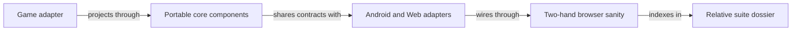

# Current Web test dossier

## Overview

Source-bound components and one short public browser flow. The public mobile-emulation check passes; physical APK/Chrome comparison on the same Android remains open.

## Reading path

Components own the combinations; E2E verifies two real hands and keeps four inline captures. Reused HTML retains its original source, verdict and bytes.

Legend: evidence boundaries

Components own combinations and deliberate negative cases without photos. Unit prerequisites have no Extent. The short E2E illustrates real actions and observations; equal policy plans do not prove native painted fonts.

## Reports and provenance

| Report | Role | Original outcome |
|---|---|---|
| [WEB-TABLE-SANITY](e2e/table-sanity/extent.html) | `PRIMARY` | `PASS` |
| [shared-adapter-contracts](component/adapters/component-report.html) | `PRIMARY` | `PASS` |
| [portable-core-components](component/core/component-report.html) | `PRIMARY` | `PASS` |
| [matrix-audit-inputs](component/matrix/component-report.html) | `SUPPLEMENTAL` | `PASS` |
| [mobile-geometry-admission](governance/current/component-report.html) | `PRIMARY` | `PASS` |

## Categories

- [Components](component/README.md)
- [E2E](e2e/README.md)
- [Governance](governance/README.md)
- [Diagnostics](diagnostics/README.md)

## Limits

The focused matrix report supplements its parent controls; do not count overlapping methods twice. Current APK qualification has its own [release index](../0.24.0/reports/README.md).
