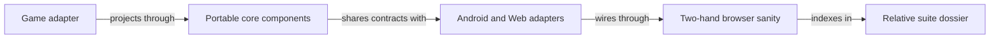

# Current Web test dossier

## Overview

Portable suite index with relative links and immutable original HTML. Current scope: source-bound components and one local browser sanity flow. Public-static and native-widget acceptance remain open; the previous public revision has its own retained receipt.

## Reading path



<details>
<summary>Legend: evidence boundaries</summary>

Components own combinations and deliberate negative cases without photos. Unit prerequisites have no Extent. The short E2E illustrates real actions and observations; equal policy plans do not prove native painted fonts.

</details>

## Reports and provenance

| Report | Original outcome | Role | Validator revision |
|---|---|---|---|
| [Two-hand Web sanity](e2e/table-sanity/extent.html) | `PASS` | `PRIMARY` | `87f47c29` |
| [Shared adapter contracts](component/adapters/component-report.html) | `PASS` | `PRIMARY` | `87f47c29` |
| [Portable core components](component/core/component-report.html) | `PASS` | `PRIMARY` | `87f47c29` |
| [Focused matrix audit inputs](component/matrix/component-report.html) | `PASS` | `PRIMARY` | `87f47c29` |
| [Resumed governance control](governance/resume/component-report.html) | `PASS` | `PRIMARY` | `838afaca` |
| [Original partially failed batch](diagnostics/initial-governance/component-report.html) | `FAIL` | `REJECTED` | `87f47c29` |

## Categories

- [Components](component/README.md): controlled inputs, comparisons and negative cases
- [E2E](e2e/README.md): ordered steps, assertions and four inline captures
- [Governance](governance/README.md): original outcomes, targeted rerun and report review
- [References](reference/README.md): previous public delivery, explicitly scoped
- [Diagnostics](diagnostics/README.md): preserved original failure

## Selection and limits

- [The module × level matrix](../../docs/testing/ATF_TestingGuide.md) identifies executable owners.
- [Continuity](../../docs/testing/ATF_TableContinuity.md) places resolution, text, actor and winner combinations in components.
- The E2E checks two one-card hands, manual then AutoGame, at one readable 1664×916 viewport.
- No new APK or native UI execution is claimed.

## Integrity and maintenance

The [manifest](index.json) binds exact bytes, SHA-256, source and scope. [Core execution](component/core/execution.json) reconciles 50 component invocations; [unit metadata](component/core/unit-execution.json) records three isolated units without retaining XML or creating Extent. [Original source inventory](component/core/source-provenance.json) retains its relative input manifests.

[Interactive report review](governance/browser-review/execution.json) observed standard Overview charts, no Overview gallery, component reports without photos, and the E2E's ordered steps and captures. [Previous public delivery](e2e/oh-hell/delivery.json) stays a reference to revision 0.11, not proof of the local 0.12 runtime.

```powershell
node .\atf-tests\tools\web-release-dossier.mjs $ProjectRoot
```

Replace obsolete results only after a new source-bound selection is retained. Preserve failed verdicts and explicit reuse; do not relabel a previous report as a fresh run. [Android catalog](../README.md) · [Test strategy](../../docs/testing/README.md)
