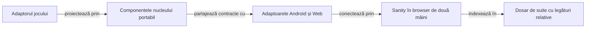

# Dosarul curent al testelor Web

## Pe scurt

Componente legate de sursă și un singur flux public scurt în browser. Verificarea cu emulare mobilă trece; comparația fizică APK/Chrome pe același Android rămâne deschisă.

## Parcurs de lectură

Componentele dețin combinațiile; E2E verifică două mâini reale și păstrează patru capturi inline. HTML-ul reutilizat își păstrează sursa, verdictul și octeții originali.

Legendă: limitele dovezilor

Componentele dețin combinațiile și cazurile negative deliberate, fără poze. Unitățile prealabile nu au Extent. E2E-ul scurt ilustrează acțiuni și observații reale; planurile logice egale nu dovedesc fonturile desenate nativ.

## Rapoarte și proveniență

| Raport | Rol | Verdict original |
|---|---|---|
| [WEB-TABLE-SANITY](e2e/table-sanity/extent.html) | `PRIMARY` | `PASS` |
| [shared-adapter-contracts](component/adapters/component-report.html) | `PRIMARY` | `PASS` |
| [portable-core-components](component/core/component-report.html) | `PRIMARY` | `PASS` |
| [matrix-audit-inputs](component/matrix/component-report.html) | `SUPPLEMENTAL` | `PASS` |
| [mobile-geometry-admission](governance/current/component-report.html) | `PRIMARY` | `PASS` |

## Categorii

- [Componente](component/README.md)
- [E2E](e2e/README.md)
- [Guvernanță](governance/README.md)
- [Diagnostice](diagnostics/README.md)

## Limite

Raportul matricelor focalizate completează controalele părinte; nu număra de două ori metodele suprapuse. Calificarea APK curentă are propriul [index de release](../0.24.0/reports/README.md).
