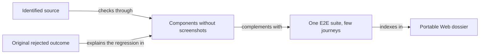

# Current Web test dossier

## Overview

Portable index for Whist Web artifacts. Original evidence remains standalone; every report link is relative and works after copying the complete directory.

**State: browser-qualified.** Published revision 0.11 matches the executed browser resources under the delivery receipt's explicit comparison rules. Physical APK/Chrome comparison remains open.

## Reading path



<details>
<summary>Legend: levels and limits</summary>

Components own combinations of dimensions, text, anchors and event order. E2E retains few relevant journeys, with before/after steps and images; copying a reference report does not make it current qualification.

</details>

## Reports and provenance

| Report | Original outcome | Role | Validator revision |
|---|---|---|---|
| [Five/six-player illustrated handoffs](e2e/table-handoffs/extent.html) | `PASS` | `PRIMARY` | `9b57a75b` |
| [Shared every-seat APK/Web components](component/phases/component-report.html) | `PASS` | `PRIMARY` | `9b57a75b` |
| [Current ownership and source governance](governance/current/component-report.html) | `PASS` | `PRIMARY` | `9b57a75b` |
| [Android JVM contract integration](component/apk-policy/component-report.html) | `PASS` | `REFERENCE` | `9b57a75b` |
| [Earlier four-player reference](e2e/oh-hell/extent.html) | `PASS` | `REFERENCE` | `91716314` |
| [Current handoff and dossier components](component/handoff/component-report.html) | `PASS` | `REUSED` | `9a5b49b8` |
| [Report input and trace contracts](component/reporting/component-report.html) | `PASS` | `REUSED` | `91716314` |
| [Shared geometry and controlled matrices](component/native-ports/component-report.html) | `PASS` | `REUSED` | `9ec0b560` |
| [ATF governance reference](governance/atf/component-report.html) | `PASS` | `REFERENCE` | `9cc19f7f` |
| [Earlier Romanian flow reference](reference/romanian/extent.html) | `PASS` | `REFERENCE` | `91716314` |
| [Original AI-to-human displacement](diagnostics/anchor-before/extent.html) | `FAIL` | `REJECTED` | `91716314` |

## Categories

- [Components](component/README.md): preconditions, controlled data, comparisons and negative cases without product screenshots.
- [E2E](e2e/README.md): ordered actions and observations, individual assertions and inline captures.
- [Governance](governance/README.md): source, documentation and inventory contracts.
- [References](reference/README.md): previous coverage with explicit limits.
- [Diagnostics](diagnostics/README.md): original rejected evidence retained in full.

## Suite selection policy

[The testing contract](../../docs/testing/ATF_TableContinuity.md) requires screenshot-free components and minimal navigation E2E with at most two hands per game. [The migration plan](../../docs/feedback/ATF_CardUi_Extraction.md#ui-three-module-plan) keeps budget enforcement explicitly open; this documentation update adds no UI execution or APK qualification.

## Integrity and maintenance

- [Delivery verification](e2e/oh-hell/delivery.json) identifies the published source and already tested resources; it is not another E2E execution.

The [manifest](index.json) preserves each report's size, SHA-256, role and provenance. No duplicate PNGs, JUnit XML or builds are retained here; reports contain inline images.

```powershell
node .\atf-tests\tools\web-release-dossier.mjs $ProjectRoot
```

Refresh the dossier after Web qualification and verified publication; preserve original bytes and verdicts when moving a report. Documentation follows the branch language, while original HTML stays identical. [Android catalog](../README.md) · [Test strategy](../../docs/testing/README.md)
