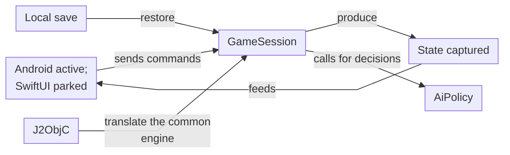

# Whist Lab Application Builds

## Overview

The Android Whist Lab app runs locally with the shared Java engine and AI opponents.
The native iOS project is parked; its SwiftUI adapter and shared-engine bridge are not currently
built, tested or release-qualified. The files remain in `../ios`; iOS is outside the active
Android and browser release scope.

## Usage

The configuration selects a variant, 3–6 players and Normal or Hard difficulty.

Select English or Romanian through the interface. The selection persists across launches, and the rules and hand schedule are available from `Rules & schedule` in the selected language.

The available variants are defined in the catalogue of rules.

A saved game using a retired variant remains on the device until the user starts a new game. The types of rules are defined in [GameMode](game-core/src/main/java/ro/whistlab/core/rules/GameMode.java), and actual texts and labels in [WhistUiText](whist-presentation/src/main/java/ro/whistlab/app/localization/WhistUiText.java). The displayed rules are built in [HowToPlay](game-core/src/main/java/ro/whistlab/core/rules/HowToPlay.java) for the variant, language and number of players selected.

- [Rules of the game](../docs/game/README.md) defines the hand schedule, trump, scoring and series for each profile.
- Open history from `Game menu → Game score → Score history`. The [history contract](../docs/game/ATF_ScoreHistory.md) explains bids, player totals, markings, and adaptation to the window.

## Aided bidding

At the player's turn, the Hard engine estimates and pre-selects a legal bid from visible information. The choice may be changed and must be confirmed by `Place bid`; the recommendation does not submit the contract. The selected Normal or Hard policy continues to control the opponents.

- The background calculation uses the player’s hand, the known trump and turned-up card, public bids and the engine’s scoring context.
- Manual selection has priority. A delayed result cannot replace it or apply to a different hand or game.
- If the estimate is not available, any legal value can be chosen manually. [Contextual selection](whist-presentation/src/main/java/ro/whistlab/app/bidding/HumanBidSelection.java) keeps this condition separate from the contracts submitted.

## Play the current hand automatically

- On Android, select `Auto play` to let the AI temporarily handle bidding and card play. The [Android activity guide](app/src/main/java/ro/whistlab/app/README.md#autogame-for-active-hand) describes flow coordination.
- The check is on the right side of the title when it fits. With the text enlarged, it can occupy its own row in the header, above the edge. The number of hands and the summary of bids appear below.
- While automation is active, `Game menu` offers `Stop auto-play`.
- The app uses the selected Normal or Hard policy for opponents and temporarily controls the human seat too. Automation stops at the hand score, and the next hand returns to manual control.

Automation only affects bidding and play in the active hand. It does not change difficulty, rules, scoring, or saved-game persistence. Dialogs and backgrounding suspend decisions; the existing AI coordinator resumes eligible work when the app returns.

## Flow and responsibilities



<details>
<summary>Legend and limits</summary>

GameSession validates the controls before changing state; the UI renders the captured state. Persistence restores only information available in the save schema.

</details>

## Organization

| Component | Responsibility |
|---|---|
| [game-core](game-core/README.md) | Rules, session, scoring, persistence and application AI policy; JVM tests. |
| [card-table-core](card-table-core/README.md) | Portable geometry, content, text roles, deterministic effects and neutral component fixtures. |
| [card-table-android](atf-card-table-ui/README.md) | Native widgets, resources and measurements; consumes core and keeps its existing physical directory. |
| [card-table-web](../atf-ui-browser/README.md) | Browser renderer and JVM/compiled-page adapter; consumes the same core contracts. |
| [whist-presentation](whist-presentation/README.md) | Game-owned portable setup, labels, public content, achievements, score rows and checkpoint codecs for both renderers. |
| [card-table-names](card-table-names/README.md) | Shared Java policy for seat-name assignment and human-name validation. |
| [app](app/src/main/java/ro/whistlab/app/) | Android activity, table configuration, game presentation and local persistence. |
| [ai-lab](ai-lab/README.md) | JVM module of independent player, tools and experiments offline; consumed only on testing. |
| [test-audit](test-audit/README.md) | JVM fixtures for component capture and verification; excluded from application runtime. |
| [algorithm-build](algorithm-build/README.md) | JVM-only Gradle entry without Android application configuration. |
| [iOS](../ios/README.md) | Parked SwiftUI adapter and shared-engine bridge; outside active release qualification. |
| [atf-test-android](../atf-test-android/README.md) | Android verification components and scenarios explicitly activated. |

The application version, the SDKs and package identifier have as source
[Gradle configuration of application](app/build.gradle). An APK built from current sources and a
APK previously installed have distinct origins; source version does not prove
[Android Acceptance Contract](../docs/testing/ATF_Android.md) defines the check of the identified binary.

## Construction and verification

| Purpose | Entry point | Resources |
|---|---|---|
| Rapid JVM Regression | `:game-core:quickRegressionTest` through `algorithm-build` | JDK and cache Gradle/JVM; without Android device. |
| APK Development | `:app:assembleDebug` | JDK, SDK Android and building dependencies. |
| Collection with identity and external result | [run-whist-collection.ps1](../scripts/run-whist-collection.ps1) | Configuration and preconditions [collection](../docs/testing/ATF_Collections.md). |

Execute compilers in your own `%TEMP%` work copy. From that copy
Director `whist-lab-app`:

```powershell
.\gradlew.bat -p algorithm-build :game-core:quickRegressionTest --offline --no-daemon
.\gradlew.bat :app:assembleDebug --offline --no-daemon
```

The first command requires JDK and locally available JVM dependencies. The second asks and
Android SDK declared in configuration; APK is produced in `app/build/outputs/apk`
`--offline` refuses dependencies that are not already in cache.

From the root of the project, [Collections launcher](../scripts/run-whist-collection.ps1)
creates its own temporary copy and accepts explicit selections such as `quick`,
`regression`, `context` and `documentation`:

```powershell
.\scripts\run-whist-collection.ps1 -Collection quick
```

Component tests, offline tournaments and Android scenarios have
distinct selections and activation. An external experimental candidate does not change the active application
merely by existing. Device access and APK installation are separate steps
that require explicit activation.

Current contracts and mechanisms are in [Documentation](../docs/).

## Integration contracts

[Coordination Android](app/src/main/java/ro/whistlab/app/README.md#automatic-turn-coordination) separates the calculation of AI from the main thread and makes it conditional on the application of the identity of the game and the captured status. The components shall verify the cancellation and single application; persistence, reactivity and interaction shall qualify separately for the identified binary.

| Surface | Input |
|---|---|
| New profile and compatible restoration | The configuration, score, restoration, AI projections and aid RO/EN use the same rules identity; the historical profile explicitly retains its values. |
| Guide and interface | Labels and access to the history of all places follow the current texts and commands; the complete procedures belong to the responsible guides. |

[Rules and score](../docs/game/README.md) owns the product contract and [Android qualifications](../docs/feedback/ATF_Android.md) keeps the criteria still open.
