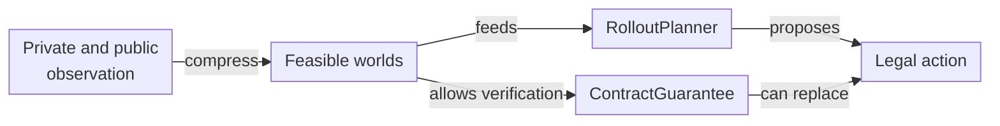

# AI Laboratory and independent player

## Overview

This JVM module brings together the independent player, offline tools and AI experiments. Player production sources have no engine, Android or ATF imports; the experiments have explicit activation and do not enter the main artifact.

[game-core/build.gradle](../game-core/build.gradle) consumes the module through `testImplementation project(":ai-lab")`. [Android test POM](../../atf-test-android/pom.xml) compiles the same sources only for Maven acceptance; the application is not dependent on the laboratory in the APK.

## Module organisation

| Area | Responsibility |
|---|---|
| [src/main/java](src/main/java/) | The independent model and observation allowed to the actor. |
| [src/test/java](src/test/java/) | Local Java contracts with legal positions built without engine or archive. |
| [tools](tools/README.md) | Corpus, models, diagnosis and qualification, with Node.js tests joined. |
| [experiments](experiments/) | Prototypes and [alternative sources of bidding](experiments/bid-models/README.md), excluded from the default compilation. |
| [build.gradle](build.gradle) | `check` combines Java and Node tests; the external replay has separate activation. |

## Input and information available

[IndependentPlayer.Position](src/main/java/ro/whistlab/coach/IndependentPlayer.java) contains the actor’s hand and public facts: the number of cards left, contracts, tricks, totals, series, cards played, current trick and the card turned.

There is no field for the actual hands of the opponents or the deal seed. Adapters build this projection before calling the AI. In Android tests, this limit is applied by [WhistChallenger](../../atf-test-android/src/test/java/atf/android/e2e/player/WhistChallenger.java).

Numeric cards use `13 × suit + rank - 2`, with suits ordered spades,
hearts, clubs and diamonds. Following suit, mandatory trumping, trick winners
and scoring are implemented independently of `game-core`.

## Flow and responsibilities



<details>
<summary>Legend and limits</summary>

Worlds are hypotheses compatible with public information. A certificate may replace the proposal only within a fully enumerated domain; budget exhaustion retains the fallback proposal. The independent player remains a verification tool separate from application policy.

</details>

## Active source policy

Bidding compares contract points on the same hypothetical worlds; card play
compares legal-card points, using the strongest opponent’s points
as a tie-breaker. Read budgets and the one-card posterior exception
from the active source’s `bid` and `card` methods. This is utility in
points, not a guarantee that the chosen contract will be made.

| Mechanism | Contract and limit |
|---|---|
| [IndependentDeals](src/main/java/ro/whistlab/coach/IndependentDeals.java) | Deals respect public cards, the turned card, remaining need and suits proven void; the feasible fallback keeps the same constraints. |
| [IndependentContinuations](src/main/java/ro/whistlab/coach/IndependentContinuations.java) | It advances the hypothetical world, tricks and scores. Simulation of decision and exhaustive diagnosis are distinct entries; diagnosis does not replace active policy. |
| [RolloutPlanner](src/main/java/ro/whistlab/coach/RolloutPlanner.java) | Models the continuation of a hypothesis; opponents’ actual hands do not enter the decision API. [Frozen references](../game-core/src/test/java/ro/whistlab/coach/baseline) remain separate in the engine tests. |
| [ContractGuarantee](src/main/java/ro/whistlab/coach/ContractGuarantee.java) | It can replace the proposal only for the complete universe and legal continuity in the allowed finite domain; incomplete enumeration or an exhausted budget preserves the initial proposal. |

Reproducibility concerns the same full input; invariance to change
common scores is not assumed. These mechanisms do not certify a perfect player.

## Verification and experiments

From the `whist-lab-app` directory of a full temporary copy of the project:

```powershell
.\gradlew.bat -p algorithm-build :game-core:test --tests ro.whistlab.coach.IndependentPlayerModelTest --tests ro.whistlab.core.ai.engine.CertifiedContractRegressionTest --offline --no-daemon
```

[IndependentPlayerModelTest](../game-core/src/test/java/ro/whistlab/coach/IndependentPlayerModelTest.java)
check the distribution generator, card ownership and finished models.
[CertifiedContractRegressionTest](../game-core/src/test/java/ro/whistlab/core/ai/engine/CertifiedContractRegressionTest.java)
separate a valid certificate from the lack of guarantee and the reserve option.

The tournaments are run only through the explicit collections and protocols in the [launcher](../../scripts/run-whist-collection.ps1).

The tools have their own verification from the same temporary copy:

```powershell
.\gradlew.bat -p algorithm-build :ai-lab:check --offline --no-daemon
```

Keep learning cases, small regressions, candidate's source and new evaluation games separately. The correctness of a component or gain in a hypothetical world is not a play force progression alone. External alternatives do not change active sources and do not promote them by simply passing a local test.

## Own verification and qualification

| Surface | Contract and limit |
|---|---|
| Java | [Local contracts](src/test/java/ro/whistlab/coach/IndependentPlayerContractTest.java) checks the observation, legality, determinism, cancellation and budgets. Engine, Android and ATF dependencies are absent from the local test classpath; comparisons in `game-core` remain integration. |
| Tools Node | `check` include `testTools`; [the legal game builder](tools/testing/legal-game-fixture.mjs) replace the default entries in the archive. The card, bid, levitated and score mutations check the validator's refusals. |
| Archive | `replayArchive` requires file and SHA-256 explicit; check bytes prior to parting and rules. It's not the dependency of `check`. |
| Data exposure | [Shared registry](../../docs/learning/ATF_EvaluationRegistry.md) coordinates reservations between the corpora and keeps reuse as known exposure. |

The promotion remains conditional on progress on new games and the identity of all sources; a successful local verification closes only her contract. [Learning protocol](../../docs/learning/README.md) holds the procedure and [Feedback AI](../../docs/feedback/ATF_Ai.md) centralises the work still open.

[PlannerControl](src/main/java/ro/whistlab/coach/PlannerControl.java) provides optional measurement and working limit, isolated on the wire.

- The interruption shall retain the marking and discard `CancellationException`; `WORK_LIMIT` shall abandon the decision by a separate exception.
- Closure of context eliminates the limit for subsequent calls.
- [Cost qualification](../../docs/ai/ATF_CostQualification.md) separates this control from the evidence budget and playing strength.

## Test catalogue

[Inputs and responsibilities of tests](src/test/README.md) explains the selection, preconditions and interpretation of the result, through the same common strategy for all deliveries.
