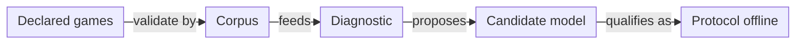

# AI laboratory tools

## Overview

The Node.js tools belong to JVM `ai-lab` module and check offline learning data or mechanisms. They keep the actor's observation, complete data of the oracle and evaluation results separately.

The implementation and tests of each mechanism shall be together, grouped in responsibility. The Gradle `:ai-lab:testTools` task runs local tests; experiments on external corpus are activated separately.

## Data flow



<details>
<summary>Legend: Analysis and promotion</summary>

The validator shall verify the rules and the score before interpreting the results. The diagnosis motivates a rule or candidate; promotion requires independent components and reserved evaluation from protocol.

</details>

## Organization

| Directory | Responsibility |
|---|---|
| [corpus](corpus/) | Game schema, curation, active-corpus analysis and example extraction. |
| [patterns](patterns/) | Honor descriptions and descriptive calibration on development data. |
| [bidding](bidding/) | Features, bidding models, controlled generation and Java pattern identified. |
| [learning](learning/) | Composition of the lots and evaluation of protocols or arena. |
| [diagnostics](diagnostics/) | Divergence, contextual pressure and finite responses. |
| [qualification](qualification/) | Explicit criteria for local corrections and candidate characteristics. |
| [testing](testing/) | A deterministic builder of legal games for components, without reading the archive. |

[Validator of candidate base](qualification/WhistCandidateSource.psm1) retains the complete inventory of sources and the final copy verification. [The contract of the manifest](../../../docs/testing/ATF_Collections.md#full-identity-of-candidate-base) holds migration, canonical hash and the boundary between base and candidate; its components use temporary directories built without archived games.

The [exposure registry](qualification/whist-evaluation-registry.mjs) coordinates evaluation ranges across corpora and treats resumption as known exposure. [Register contract](../../../docs/learning/ATF_EvaluationRegistry.md) defines identity, import of history, blocking and recovery after interruption.

- **Generic mechanism:** [intersection of the intervals](qualification/half-open-interval.mjs) is pure and receives full semi-open intervals.
- **Field Adapter:** Whist keeps distribution space, seed validation and persistence; [transferable lessons](../../../docs/learning/ATF_PolicyEvolution.md#lessons-to-other-games-and-products) explain this border.

The curator and paired-batch composer share [private staging and exclusive publication](qualification/atomic-directory.mjs). The [publication contract](../../../docs/learning/ATF_Corpus.md#atomic-tool-publication) defines immutable inputs, final-directory visibility, error retention and explicit recovery after a hard stop.

## Verification

From the `whist-lab-app` directory of a full temporary copy of the project, with Java, Node.js and the locally available Gradle dependencies:

```powershell
.\gradlew.bat -p algorithm-build :ai-lab:testTools --offline --no-daemon
```

- **Resolution:** Gradle executes Node from the root of the project copy. The imports and resources of the tools shall be resolved against the file which holds them; CLI inputs and external destinations shall be declared by the caller.
- **Local data:** tests [corpus](corpus/whist-corpus.test.mjs) and [curator](corpus/whist-active-corpus.test.mjs) use [matches constructed](testing/legal-game-fixture.mjs), with distribution, bids, legal game and score calculated separately from the validator. Temporary files belong to the test. `--offline` requires the Gradle dependencies to be available separately.
- **Reproduction:** Semantic identities of the records shall be kept when physically moving the source. The old captures shall be reproduced from their identified copy and the external directories shall not be rewritten by this organization.
- **Publication layers:** Pure [publisher unit tests](qualification/atomic-directory.test.mjs) exercise filesystem boundaries without Extent. The normal [corpus and pair components](testing/corpus-publication.test.mjs) use constructed legal games, byte comparisons and controlled failures under a 128 MiB Node heap. A separate 256-record generated-archive component runs the production curator under a 256 MiB old-space limit and records process RSS, sampled heap, traversal, copied bytes and publication. The primary orchestration suite publishes the Java adapter's assertions and inputs without images.

[Module AI](../README.md) · [Protocol](../../../docs/learning/README.md) · [Collections](../../../docs/testing/ATF_Collections.md)

## Limits and qualification

Constructed data qualifies the mechanism and its refusals; it is not new match evidence of playing-strength improvement. The archive's playbook uses separate entry from the [corpus contract](../../../docs/learning/ATF_Corpus.md#usage), with file and SHA-256 declared. No archive shall be selected by default in the components.

Tool qualification for volume and interruption remains monitored in [Laboratory feedback](../../../docs/feedback/ATF_Ai.md#autonomous-laboratory-verification).

[Protocol](../../../docs/learning/README.md) owns evaluation-set exposure and promotion. The notes and results of an assessment shall remain external; the exposure register shall not automatically certify the other tools.
