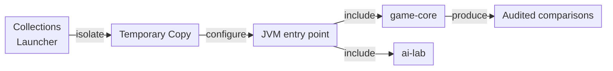

# JVM building for rules and algorithms

## Overview

This Gradle entry builds JVM modules without configuring the Android application. [settings.gradle](settings.gradle) declares `game-core`, `ai-lab`, `card-table-names` and `test-audit`; each module owns its sources, dependencies and checks.

The audited testing requires JDK 21, the Gradle project launcher and the JVM dependencies in cache. The engine keeps its declared Java target; test libraries do not enter the Android runtime. Option `--offline` refuses missing dependencies; Android SDK is not required for this entry.

## Flow and responsibilities



<details>
<summary>Legend: one engine source</summary>

The JVM entry uses neighboring projects. `game-core` consumes `ai-lab` through a test dependency; independent sources compile in their own module, and the collection launcher owns isolation and result archiving.

</details>

## Normal verification

From the project root, [Collections launcher](../../scripts/run-whist-collection.ps1) creates its own temporary copy:

```powershell
.\scripts\run-whist-collection.ps1 -Collection quick
```

[Catalogue of collections](../../config/test-collections.json) links the intention to task Gradle [Select guide](../../docs/testing/ATF_Collections.md) explains the preconditions of the research, tournaments and evaluation reserved.

## Direct use of Gradle

From the `whist-lab-app` directory of a full temporary copy of the project:

```powershell
.\gradlew.bat -p algorithm-build :game-core:quickRegressionTest --offline --no-daemon
```

The chosen task shall determine the limit of verification:

| game-core task | Contract |
|---|---|
| `quickRegressionTest` | Focused selection of rules and contexts, defined in Gradle. |
| `regressionTest` | Delegation task `test`, with its explicit exclusions. |
| `contextRegressionTest` | Contextual regressions with independent legal witnesses. |
| `documentationTest` | The contract of game aid and the texts of the rules. |
| `tasks --all` | Lists configured tasks without executing game checks. |

[game-core/build.gradle](../game-core/build.gradle) is the source of actual selections. Tournaments, error mining and research components have distinct tasks and explicit activation.

## Outputs and concurrency

- JUnit XML and build outputs appear in `game-core/build` of the temporary copy.
- [Component audit](../../docs/testing/ATF_GradleComponents.md) produces a canonical HTML per selection and temporarily confronts the claims with XMLs without counting them twice.
- `whist.componentEvidence` may select an external directory for captures of component; the identity of the captures shall be kept without overwriting.
- The two Gradle entries of the application use the same project directories included; competing executions require separate copies.
- The result identifies the sources and the execution selection; Android acceptance and playing-strength measurement have separate criteria.

[Engine](../game-core/README.md) · [Testing](../../docs/testing/README.md) · [Learning offline](../../docs/learning/README.md)
