# Native Android graphics components

## Overview

[Marking test](java/ro/whistlab/app/score/nativecomponent/HistoryMarksComponentInstrumentation.java) builds the production classes in a real `FrameLayout`, without an Activity, game or private data. Android measures text and applies internal scrolling before drawing through the parent; direct drawing of child on an empty Canvas does not reproduce this contract.

| Level | Oracle and limit |
|---|---|
| Native component | The presence of distinct ink of the cut for the missed contract and its absence for the exact contract; the point frame appears exclusively for adjustment, with different colors to the bonus and penalty. |
| Matrix | Bid values, width and font scales; the numerical text has neutral ink to prevent substitution of the marking in pixel verification. |
| Evidence | Each case publishes the entry, the deployment of Android, the number of pixels, the verdict and the native PNG base64. These cases are not JVM JUnit invocations and do not increase the total JVM tests. |

```mermaid
%%{init: {"themeVariables":{"fontSize":"15px"},"themeCSS":".edgeLabel, .edgeLabel p { font-size: 12px !important; } .node rect { rx: 6px; ry: 6px; }","flowchart":{"curve":"linear","nodeSpacing":24,"rankSpacing":22,"padding":6},"sequence":{"mirrorActors":false,"messageMargin":24,"wrap":true}}}%%
flowchart LR
    Fixture["Controlled values"] -->|binds| View["Production views"]
    View -->|measures and lays out| Android["FrameLayout"]
    Android -->|draws through parent| Raster["PNG"]
    Raster -->|compares ink| Assert["Native assertions"]
```




<details>
<summary>Legend — ownership and verification boundary</summary>

The instrumentation uses actual Android layout and parent drawing for the production views. The controlled fixture distinguishes marking ink from numeric text; the PNG and pixel counts belong to that native case. It does not execute a full match or add a JVM JUnit invocation.

</details>

## Execution

Build in an identified external workspace with the existing SDK and development key:

```powershell
gradle :app:assembleDebugAndroidTest --offline
adb install -t app/build/outputs/apk/androidTest/debug/app-debug-androidTest.apk
adb shell am instrument -w ro.whistlab.app.test/ro.whistlab.app.score.nativecomponent.HistoryMarksComponentInstrumentation
```

Gradle configuration declares the runner itself; the default runner does not perform these samples. Check the identity and certificate of the target APK, book the device and keep the application status as per [relay qualification](../../../../docs/testing/ATF_ReleaseQualification.md).

- Tests run on the UI thread, keep the device's overall configuration and do not start navigation.
- Reflective access to the bid producer remains exclusively in the sample: the production class has package visibility and does not become public API for testing.
- The runner uses a negative result code for success; read the verdict from `failures` and the instrumentation result, not only the ADB process exit code.

[JVM components](../test/README.md) · [Raster alternative](../rasterTest/README.md) · [Common strategy](../../../../docs/testing/README.md)
