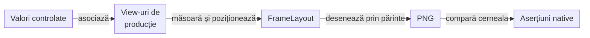

# Componentele grafice Android native

## Pe scurt

[Proba marcajelor](java/ro/whistlab/app/score/nativecomponent/HistoryMarksComponentInstrumentation.java) construiește clasele de producție într-un `FrameLayout` real, fără activitate, partidă ori date private. Android măsoară textul și aplică derularea internă înaintea desenării prin părinte; desenarea directă a copilului pe un Canvas gol nu reproduce acest contract.

| Nivel | Oracol și limită |
|---|---|
| Componentă nativă | Prezența cernelii distincte a tăieturii pentru contract ratat și absența ei pentru contract exact; cadrul punctelor apare exclusiv pentru ajustare, cu culori diferite la bonus și penalizare. |
| Matrice | Valori de licitație, lățimi și scări de font; textul numeric are cerneală neutră pentru a nu putea substitui marcajul în verificarea pixelilor. |
| Dovadă | Fiecare caz publică intrarea, derularea Android, numărul de pixeli, verdictul și PNG-ul nativ base64. Aceste cazuri nu sunt invocări JUnit și nu măresc totalul testelor JVM. |




<details>
<summary>Legendă — responsabilitate și limita verificării</summary>

Instrumentarea folosește layout Android real și desenarea prin părinte a view-urilor de producție. Fixture-ul controlat distinge cerneala marcajului de textul numeric; PNG-ul și numărul pixelilor aparțin acelui caz nativ. Nu execută o partidă completă și nu adaugă o invocare JUnit JVM.

</details>

## Execuție

Construiți într-un workspace extern identificat, cu SDK-ul și cheia de dezvoltare existente:

```powershell
gradle :app:assembleDebugAndroidTest --offline
adb install -t app/build/outputs/apk/androidTest/debug/app-debug-androidTest.apk
adb shell am instrument -w ro.whistlab.app.test/ro.whistlab.app.score.nativecomponent.HistoryMarksComponentInstrumentation
```

Configurația Gradle declară runnerul propriu; runnerul implicit nu execută aceste probe. Verificați identitatea și certificatul APK-ului țintă, rezervați dispozitivul și păstrați starea aplicației conform [calificării release-ului](../../../../docs/testing/ATF_ReleaseQualification.md).

- Testele rulează pe firul UI, păstrează configurația globală a dispozitivului și nu pornesc navigarea.
- Accesul reflectiv la constructorul de licitație rămâne exclusiv în probă: clasa de producție are vizibilitate de pachet și nu devine API public pentru testare.
- Runnerul returnează cod negativ la succes; verdictul se citește din `failures` și rezultatul instrumentării, nu numai din codul procesului ADB.

[Componente JVM](../test/README.md) · [Raster alternativ](../rasterTest/README.md) · [Strategia comună](../../../../docs/testing/README.md)
