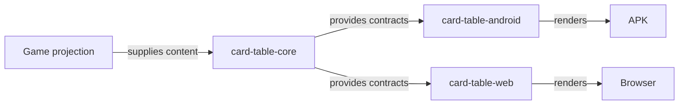

# Card Table Core

## Overview

Portable presentation contracts for card games. This Java module owns geometry, content, text roles, hand feedback and collection timing. It has no Android, DOM, storage, game-engine or reporting dependency in production.

## Responsibility boundaries

Legend — contracts and rendering

The game owns legal actions, scoring and public projections. Core owns platform-neutral models and calculations. Adapters apply units, measurements, input and lifecycle to their own renderer; an equal plan does not establish equal painted pixels.

## Build and compatibility

The Gradle project is `:card-table-core`; `-Pcardui.only=core` selects its build and audit support without applying an Android plugin. Java packages remain stable so native and browser consumers retain their public types. The Android adapter keeps its existing physical directory and publishes a dependency on core.

Use the repository's configured external build directory and caches. [Execution and paths](../../scripts/README.md)

## Verification

| Source set | Responsibility | Output |
|---|---|---|
| `src/main/java` | Models, geometry, typography and deterministic effects. | Runtime JAR. |
| `src/test/java` | Public component contracts, preconditions, comparisons and negative controls. | Canonical Extent reconciled with JUnit; no continuity pictures. |
| `src/testFixtures/java` | Immutable measurements and a neutral continuity oracle; no game or reporting imports. | Test-fixtures JAR for adapter components. |
| `src/unitTest/java` | Small isolated calculations and snapshot ownership. | JUnit diagnostics; no Extent. |

Run `:card-table-core:test` for components and `:card-table-core:unitTest` for units. `:card-table-core:check` selects both. Resolution, text scale, all seats and game-provider matrices belong to components; platform E2E retains only short navigation and interaction sanity flows.

[Module × level matrix](../../docs/testing/ATF_TestingGuide.md) · [Shared table contract](../../docs/testing/ATF_TableContinuity.md) · [Current Web evidence](../../release/WEB/README.md)
