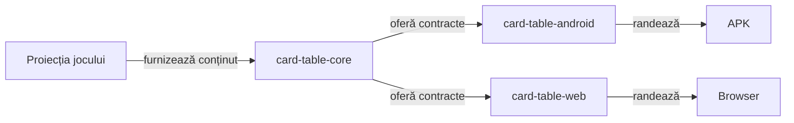

# Card Table Core

## Pe scurt

Contracte portabile de prezentare pentru jocuri de cărți. Acest modul Java deține geometria, conținutul, rolurile textului, feedbackul mâinii și temporizarea colectării. Codul de producție nu depinde de Android, DOM, stocare, motorul jocului sau raportare.

## Limitele responsabilităților

Legendă — contracte și randare

Jocul deține acțiunile legale, punctajul și proiecțiile publice. Core deține modelele și calculele independente de platformă. Adaptoarele aplică unitățile, măsurătorile, intrarea și ciclul de viață rendererului propriu; planurile egale nu demonstrează egalitatea pixelilor desenați.

## Construire și compatibilitate

Proiectul Gradle este `:card-table-core`; `-Pcardui.only=core` selectează construirea și suportul de audit fără aplicarea unui plugin Android. Pachetele Java rămân stabile, astfel încât consumatorii nativi și browser să păstreze tipurile publice. Adaptorul Android păstrează directorul fizic existent și publică o dependență către core.

Folosiți directorul extern de construire și cache-urile configurate în proiect. [Execuție și căi](../../scripts/README.md)

## Verificare

| Set de surse | Responsabilitate | Rezultat |
|---|---|---|
| `src/main/java` | Modele, geometrie, tipografie și efecte deterministe. | JAR de execuție. |
| `src/test/java` | Contracte publice de componentă, precondiții, comparații și controale negative. | Extent canonic reconciliat cu JUnit; fără poze de continuitate. |
| `src/testFixtures/java` | Măsurători imuabile și oracol neutru de continuitate; fără importuri din joc sau raportare. | JAR de fixture-uri pentru componentele adaptoarelor. |
| `src/unitTest/java` | Calcule izolate și proprietatea snapshoturilor. | Diagnostice JUnit; fără Extent. |

Rulați `:card-table-core:test` pentru componente și `:card-table-core:unitTest` pentru unitare. `:card-table-core:check` le selectează pe ambele. Matricele de rezoluție, scară a textului, toate locurile și cazurile furnizate de joc aparțin componentelor; E2E de platformă păstrează doar parcursuri scurte de navigare și interacțiune.

[Matrice modul × nivel](../../docs/testing/ATF_TestingGuide.md) · [Contractul comun al mesei](../../docs/testing/ATF_TableContinuity.md) · [Dovezi Web curente](../../release/WEB/README.md)
