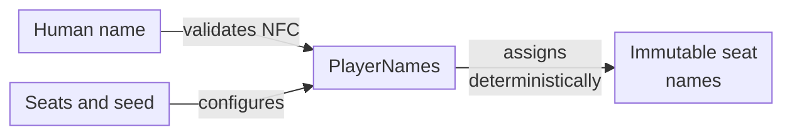

# Name of the players at the table

## Overview

`ro.cardtable:card-table-names:0.1.0` is a Java 17 JAR providing neutral name policy: NFC normalization, validation and deterministic opponent names by seat.




<details>
<summary>Legend — ownership and verification boundary</summary>

PlayerNames normalizes and validates the human name, excludes it from opponent candidates case-insensitively and returns seat order with the human at 0. Name randomness is separate from dealing and AI; the consumer owns preferences and rendered-name acceptance. The actual component check is in game-core rather than an empty test task in this library.

</details>

## Contract

- For 3–6 players, the human occupies seat 0; opponent candidates exclude that name case-insensitively.
- The same entry produces the same immutable list in order of seats. Name generation uses a random stream separate from dealing and AI.
- The consumer owns preferences, seat identities, and persistence. The library remains independent of Android and the rules of the game.

## Verification and publication

Component tests check the policy and recovery of the game by `game-core`. Consumers separately verify rendered names and restoration.

Run from `whist-lab-app` in a complete isolated project copy. The first command executes the named component test; publication is a separate task.

```powershell
.\gradlew.bat -p algorithm-build :game-core:test --tests ro.whistlab.core.player.PlayerNamesComponentTest --offline --no-daemon
.\gradlew.bat -p algorithm-build :card-table-names:publishReleasePublicationToIsolatedRepository --offline --no-daemon -Pcardui.repository=<repository-extern>
```

[Shared Android renderer](../atf-card-table-ui/README.md)
