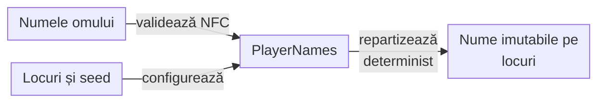

# Numele jucătorilor de la masă

## Pe scurt

`ro.cardtable:card-table-names:0.1.0` este un JAR Java 17. El furnizează politica neutră de nume, inclusiv validarea NFC și repartizarea adversarilor pe locuri.




<details>
<summary>Legendă — responsabilitate și limita verificării</summary>

PlayerNames normalizează și validează numele omului, îl exclude fără diferențiere de majuscule din candidații adversarilor și întoarce ordinea locurilor cu omul la 0. Aleatoriul numelor este separat de distribuire și AI; aplicația deține preferințele și acceptanța numelor randate. Verificarea efectivă de componentă este în game-core, fără a fi înlocuită de un task de test gol al bibliotecii.

</details>

## Contract

- La mesele de 3–6 jucători, omul ocupă locul 0. Numele său este exclus din lista adversarilor fără diferențiere de majuscule.
- Aceeași intrare produce aceeași listă imutabilă, în ordinea locurilor. Generatorul folosește un flux separat de distribuire și de AI.
- Consumatorul își gestionează preferințele, identitatea locurilor și salvarea. Biblioteca rămâne independentă de Android și de regulile jocului.

## Verificare și publicare

Testele de componentă verifică politica și recuperarea partidei prin `game-core`. Consumatorii verifică separat numele randate și restaurarea.

Rulează din `whist-lab-app`, într-o copie completă și izolată a proiectului. Prima comandă execută testul de componentă numit; publicarea este un task separat.

```powershell
.\gradlew.bat -p algorithm-build :game-core:test --tests ro.whistlab.core.player.PlayerNamesComponentTest --offline --no-daemon
.\gradlew.bat -p algorithm-build :card-table-names:publishReleasePublicationToIsolatedRepository --offline --no-daemon -Pcardui.repository=<repository-extern>
```

[Rendererul Android comun](../atf-card-table-ui/README.md)
