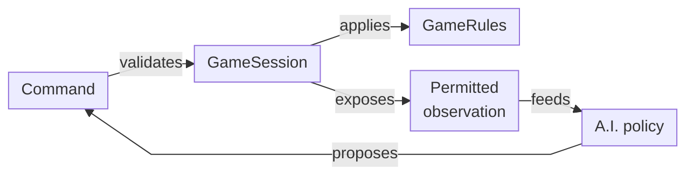

# Whist Rules Engine

## Overview

The Java engine owns configuration, rules, transitions, score history and playing policy. Android and JVM builds consume the same sources; production remains independent of Android, ATF and JUnit.

Tests check the domain through independent properties and oracles. [JVM entry point](../algorithm-build/README.md) allows offline work, and [Variant Guide](../../docs/game/README.md) has the full explanation of the rules.

- [AI lab](../ai-lab/README.md) is a test-only Gradle dependency. Its independent policy compiles in its own module; the engine artifact retains only engine production sources.

## Domain flow



<details>
<summary>Legend: session state and actor's observation</summary>

The session retains the complete state needed for play and restoration. The [AiPolicy](src/main/java/ro/whistlab/core/ai/policy/AiPolicy.java) facade builds the policy observation through the observation adapters: own hand and public information. The full distribution used by the session and audit shall not become input into the decision algorithm.

</details>

## Contracts in code

| Area | Responsibility |
|---|---|
| [GameConfig](src/main/java/ro/whistlab/core/config/GameConfig.java) | Player count, variant, difficulty, seed and streak configuration. |
| [GameRules](src/main/java/ro/whistlab/core/rules/GameRules.java) | Deck, hand schedule, bids, legal cards, trick winner and baseline score. |
| [RomanianScoring](src/main/java/ro/whistlab/core/rules/RomanianScoring.java) | Contract points and series evolution. |
| [GameSession](src/main/java/ro/whistlab/core/session/GameSession.java) | Command facade, hand progression and match-state projection. |
| [HandPlay](src/main/java/ro/whistlab/core/session/HandPlay.java) | Distribution, bids, order of the moves and the public history of the current hand. |
| [PlayerScore](src/main/java/ro/whistlab/core/session/scoring/PlayerScore.java) | Calculates each player’s total and streak when a hand closes. |
| [SessionCheckpoint](src/main/java/ro/whistlab/core/session/SessionCheckpoint.java) | Captures the persistence contract and reconstructs validated state. |
| [ScoreHistory](src/main/java/ro/whistlab/core/session/ScoreHistory.java) | Records bids and known trick counts; hand points are differences between cumulative totals. |
| [HowToPlay](src/main/java/ro/whistlab/core/rules/HowToPlay.java) | RO/EN help for the selected profile and hand schedule. |

## Romanian Whist

The profile accepts 3–6 players and a reduced deck of the highest `8 × N` cards. [GameMode](src/main/java/ro/whistlab/core/rules/GameMode.java) selects the variant, and `GameRules.handSizes` defines the schedule; variants with close names retain separate contracts.

- Follow the led suit; when void in it, play a trump if available. Overtrumping is not mandatory.
- The highest trump wins, otherwise the highest card of the led suit; the winner leads the next trick.
- The bid is in the range of the hand, and the last bid cannot make the sum equal the hand’s trick count.
- The exact contract grants `5 + levate`; the failure decreases the absolute difference.
- The optional series uses the explicit values of GameConfig. `newMatch` applies symmetrically 5 or 10, and the compatibility constructor receiving only the positive bonus retains the historical penalty of 5; eligibility and interruption are defined by `RomanianScoring`.

[Rules RO/EN](../../docs/game/README.md) explains the distribution, the trump, the schedule and the series. The configuration is explicit: the four-argument compatibility producer keeps the series disabled and the other forms validate their options.

## Session and persistence

The hand rejects illegal commands before changing state. After the last trick, the facade applies scoring and records totals; `ScoreHistory` advances one hand at a time and preserves known information.

- `restoreComplete` requires the full public history. The restoration of compatibility keeps the known origin of the score; [history contract](../../docs/game/ATF_ScoreHistory.md) specify the data missing from the old saves and the limit of historical trick counts.
- The Android JSON schema belongs to [GameSessionStore](../app/src/main/java/ro/whistlab/app/persistence/GameSessionStore.java). Validation of the domain and serialization of Android have distinct responsibilities and tests.

## Normal and Hard policies

[AiDifficulty](src/main/java/ro/whistlab/core/config/AiDifficulty.java) displays the two levels and the compatibility alias for old saves. The `AiPolicy` facade selects policy and isolates the observation before calculation.

- **Normal** follows the contract and avoids additional tricks after its completion, within the limits of legal action.
- **Hard** compares world-based continuations compatible with known public information, needs and contracts; [MonteCarloAi](src/main/java/ro/whistlab/core/ai/engine/MonteCarloAi.java) owns decision composition.
- **Evaluation and ordering:** `DecisionEvaluation` calculates continuation utility, and `DecisionOrdering` compares the alternatives already assessed; API and random flow remain in the coordinator.
- The final certificates and the recovery of impossible contracts have explicit conditions and budgets; the exhaustion of a budget retains the basic proposal.

| Control | Contract |
|---|---|
| [SearchCancellation](src/main/java/ro/whistlab/core/ai/simulation/SearchCancellation.java) | Checks interruption at sampling, simulation and search boundaries; abandons calculation, preserves interrupt status and lets the turn owner invalidate the result. |
| [SearchWork](src/main/java/ro/whistlab/core/ai/simulation/SearchWork.java) | Work accounting and an optional thread-local global limit without changing the random generator or utility; exhaustion throws a distinct exception without partial decision. |
| [JVM cost rating](../../docs/ai/ATF_CostQualification.md) | Separate measurement, overall limit and certificate budget; incomplete proof retains its legal proposal. |

[Decision model](../../docs/ai/ATF_DecisionModel.md) and [configurable rules](../../docs/ai/ATF_RulesConfiguration.md) delimit active behaviour by research assumptions. A checkable estimate or local certificate does not guarantee a win in every hidden-information game.

## Offline execution

From the project root, [Launcher](../../scripts/run-whist-collection.ps1) prepares temporary copy and retains external results:

```powershell
.\scripts\run-whist-collection.ps1 -Collection quick
.\scripts\run-whist-collection.ps1 -Collection context
```

[Gradle configuration](build.gradle) and [catalogue of collections](../../config/test-collections.json) define the selections. `regression` performs the regression task with the declared exclusions, and `documentation` checks the game aid; learning, arena and research are explicitly chosen.

In a temporary copy of `whist-lab-app`, the direct entry shall be:

```powershell
.\gradlew.bat -p algorithm-build :game-core:quickRegressionTest --offline --no-daemon
```

[Test architecture](../../docs/testing/ATF_Architecture.md) delimits components, integration and Android. [Learning offline](../../docs/learning/README.md) explains the extraction of small regressions, comparisons on the same distributions and qualification on new games.

## Limits and qualification

The operational cost, interpretation of probabilities and strategic progress have distinct fields and checks. [AI criteria](../../docs/feedback/ATF_Ai.md) tracks open work, including Hard composition and boundary qualification through semantic mutants.

An extraction retains the behaviour and sources of the reference policies. [Documentation rules](../../docs/governance/ATF_Documentation.md) require the same description of the new profile and compatibility in all summaries.

## Test catalogue

[Inputs and responsibilities of tests](src/test/README.md) explains the selection, preconditions and interpretation of the result, through the same common strategy for all deliveries.
