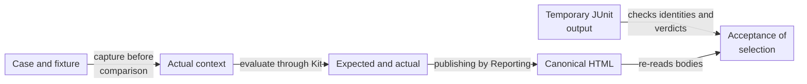

# Audit of Gradle components

## Overview

This JVM module supplies test fixtures only. Its JUnit 4 bridge captures actual context and comparisons through Test Kit and publishes through the physical Reporting artifact; application and UI AAR runtimes do not depend on it.

## Selection flow

Legend: execution and publication

A JUnit rule owns the invocation, including before/after fixtures, and measures duration before publication. Gradle temporarily retains XML for independent counting; delivery retains one HTML per selection after reconciliation.

## Contracts

- The context shall be captured at execution before the first comparison, including parametric values and local fixtures. Source code does not replace the observed values.
- JUnit 4 keeps runners and parametrizations; the bridge adapts assertion-message order to Kit.
- The lack of context, lack of comparison, a missing invocation, duplication or divergent verdict prevents acceptance.
- The declared rasters are PNG inline, labelled as JVM fixture. No Android captures.
- The catalogue classifies units, components, governance and learning; learning selections remain opt-in.
- One worker and one HTML per task avoid unqualified competition; closure and final validation belong to the selection.

## Running tests

Gradle test tasks apply the bridge automatically. `whist.auditOutput` chooses the report directory and `whist.auditSource` fixes the identity of the source inventory for qualification. The final check compares HTML with original JUnit and the library inspector; the mere existence of the file is not acceptable.

The versions of the kit and the reporting are read from `atf.testkit.version` and `atf.reporting.version` of the root POM. The configuration refuses local pairs JAR/POM absent or with divergent coordinates; does not duplicate versions and does not select Reporting by lexical sorting in the Gradle build.
